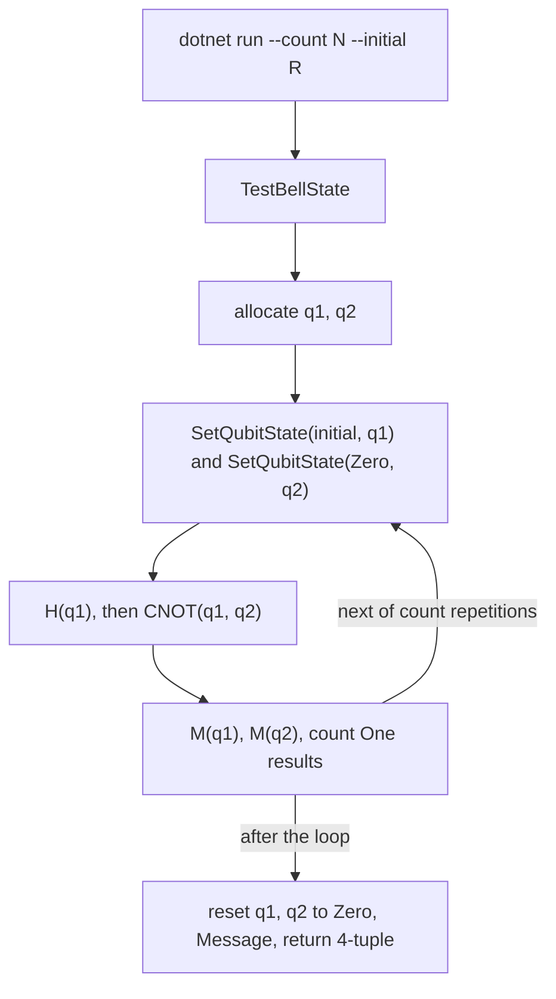

# my-microsoft-azure-quantum-learning - documentation

A learning repository with one Q# exercise. `Program.qs` prepares a Bell state
on two qubits with `H` and `CNOT`, measures both qubits a given number of times
and returns how often each qubit read `Zero` and `One` (`Program.qs:13-49`). The
root README describes it as one person's notes from learning Q#
(`README.md:3-6`); no other audience is named.

The requirements reverse-engineered from the code are in [SPEC.md](../SPEC.md).

## Status

- Last change to the exercise code: commit `e65b8cc`, 2023-07-20
  ("Entanglement between two qubits"), per `git log -- Program.qs`.
  An MIT licence was added on 2026-08-05 (`a6ac416`). On 2026-11-07 commit
  `b97ad6e` moved the four JPEG files into Git LFS (the checked-out sizes match
  the 2023 originals), and the lab tooling, `CLAUDE.md` and a rewritten
  `README.md` followed (commits `6f94100` to `9b58bf8`).
- Earlier exercises (hello world, superposition, interference, relative phases)
  exist only in git history, commits `96a22be` to `5f1ce56`; only the
  entanglement exercise is in the tree (`README.md:4-6`).
- Tests: none for `Program.qs`. `recipe.ps1 test` runs pytest over `.claude`
  (`recipe.ps1:45-46`), which holds no Python files; `pytest --collect-only`
  reported "no tests collected" on 2026-11-18.
- CI: the template's Gitea workflows are present in `.gitea/workflows/`. None of
  them builds or runs `Program.qs` (`README.md:30-31`). Whether a runner serves
  this repository is not recorded in the repository.

## Layout

| Path | What it is |
|---|---|
| `Program.qs` | The Q# exercise, namespace `ExploreEntanglement` |
| `MicrosoftAzureQuantum.csproj` | .NET project file: `Microsoft.Quantum.Sdk/0.28.277227`, `net6.0`, `Exe` |
| `Pictures/` | Four JPEG photographs of handwritten notes (superposition and interference, H, Pauli X, Pauli Y and CNOT matrices, Bell-state calculation), stored in Git LFS (`.gitattributes:10`) |
| `README.md` | Project README |
| `CLAUDE.md` | Working rules for the repository |
| `LICENSE` | MIT licence |
| `recipe.ps1` | The repository's command interface (see "Repository tooling") |

## Architecture

One Q# source file compiled by the Q# SDK into a .NET executable
(`MicrosoftAzureQuantum.csproj:1-6`). There are two operations:

- `SetQubitState(desired, target)` measures `target` with `M` and applies `X`
  when the result differs from `desired` (`Program.qs:7-11`).
- `TestBellState(count, initial)` is the `@EntryPoint()` (`Program.qs:13-14`).



No external service is used. The csproj names no execution target and the code
holds no Azure Quantum workspace settings; which simulator `dotnet run` uses is
decided by the SDK, not by this repository.

## Build and run

Prerequisites, from `README.md:21` and `MicrosoftAzureQuantum.csproj:1-5`:
the .NET SDK able to build `net6.0`, and the Q# SDK
`Microsoft.Quantum.Sdk` 0.28.277227 (restored by `dotnet` from the project file).
Git LFS is needed to get the images instead of pointer files (`.gitattributes:10`).

Run, from the repository root (`README.md:24-26`):

```shell
dotnet run --count 1000 --initial 1
```

No build or run step for the exercise exists in `recipe.ps1`; its `build` and
`run` verbs print `nothing to build` / `nothing to run` (`recipe.ps1:69-72`).

## Configuration

| Name | Kind | Meaning | Default |
|---|---|---|---|
| `--count` | CLI option (from the `count : Int` parameter, `Program.qs:14`) | Number of repetitions | none |
| `--initial` | CLI option (from the `initial : Result` parameter, `Program.qs:14`) | Starting state of `q1` before `H` | none |
| `.claude/.env` | File read by `recipe.ps1:30-38` | `NAME=value` lines exported into the environment, unless already set; gitignored (`.gitignore:24`) | absent |

The exercise reads no environment variables and no configuration file.

## Usage

Run 1000 repetitions with `--initial 1` (`README.md:25`; whether this SDK
version reads `1` as the `Result` value `One` was not checked, see
[SPEC.md](../SPEC.md#9-open-questions)). The program prints
`q1:Zero, One  q2:Zero, One` (`Program.qs:48`) and returns
`(count - numOnesQ1, numOnesQ1, count - numOnesQ2, numOnesQ2)` (`Program.qs:49`).

Inference from the circuit, not from a run: after `H` and `CNOT` both qubits
are measured equal in every repetition on a noiseless simulator, so the two
pairs in the result should be equal, each near `count / 2`; `initial` changes
only the sign of the Bell state and should not change the counts.

## Testing

There are no tests of the Q# code. `.\recipe.ps1 test` (`recipe.ps1:41-55`) sets
`core.hooksPath`, runs `python -m pytest .claude` (exit 5, no tests collected, is
accepted), then `ruff check` and `ruff format` over `.claude`. `.claude`
contains no Python files (PowerShell and shell hooks, `settings.json`, one
skill and the pytest and ruff configs), so these steps check no project code.

## Known limitations and problems

- `Program.qs` is not built, run or tested by `recipe.ps1` or the workflows
  (`README.md:30-31`).
- `README.md:33-34` says all verbs other than `test` and `info` print
  `nothing to <verb>`; `clean` instead deletes `__pycache__`, `.pytest_cache`
  and `.ruff_cache` directories (`recipe.ps1:63-68`).
- The lab-requirements link in `README.md:42` points to `127.0.0.1:3000`, and
  issues `#7`-`#11` live on that Gitea instance; neither resolves for a reader
  of the public repository.
- Commit `b97ad6e` says it pins ruff and pytest; only ruff is pinned
  (`.claude/ruff.toml:2`), `.claude/pytest.ini` holds no version.
- `Program.qs:2` and `Program.qs:4-5` open `Microsoft.Quantum.Canon`,
  `Microsoft.Quantum.Diagnostics` and `Microsoft.Quantum.Measurement`; by
  reading, no symbol from them is used (`M`, `X`, `H`, `CNOT` and `Message`
  come from `Microsoft.Quantum.Intrinsic`).
- Without Git LFS a clone holds 131-byte pointer files in `Pictures/`
  (size change shown by `git show --stat b97ad6e`).

## Repository tooling

The repository follows
[repo-quality-template](https://github.com/IGORSVOLOHOVS/repo-quality-template),
lab requirements revision 4.0.0, except R-02, R-09, R-37, R-41 and R-42
(`README.md:42`). Specific to this project:

- `recipe.ps1:9-17`: `$Name = 'my-microsoft-azure-quantum-learning'`,
  `$Code = 'mmaq'`, `$Version = '1.0.0'`, `$Needs`, `$Tools` and `$Provides`
  empty, no `$App` - nothing is installed or provided to another project.
- Verbs that act: `test`, `info`, `clean` (`recipe.ps1:41-68`). `build`,
  `install`, `uninstall`, `run`, `publish` print `nothing to <verb>`.
- Deviations: `.claude/.env` is gitignored and never committed (`.gitignore:20-24`,
  `CLAUDE.md` rule 4); `.claude/pytest.ini` and `.claude/ruff.toml` (ruff
  `==0.16.1`) are added; `$ErrorActionPreference` is `Stop` in `recipe.ps1:25`;
  the pre-lab history was imported unchanged (`CLAUDE.md`, "Where this
  repository is deliberately relaxed").

## Related documents

- [SPEC.md](../SPEC.md) - software requirements specification
- [README.md](../README.md) - project README
- [CLAUDE.md](../CLAUDE.md) - repository rules
- [LICENSE](../LICENSE) - MIT licence
- [Pictures/](../Pictures/) - handwritten notes

## About this document

Written 2026-11-18 from commit `92d511e` (branch `release`). Checked with:
`git ls-files`, `git log` on the project files, `git show` of earlier commits,
`.\recipe.ps1 info` (printed the metadata, exit 0), and
`python -m pytest --collect-only -q .claude -c .claude/pytest.ini`
("no tests collected"). Not run: `dotnet run` (no .NET SDK on the documenting
machine), `.\recipe.ps1 test` (it writes git config and formats files in place;
ruff is not installed there), the Gitea workflows.
